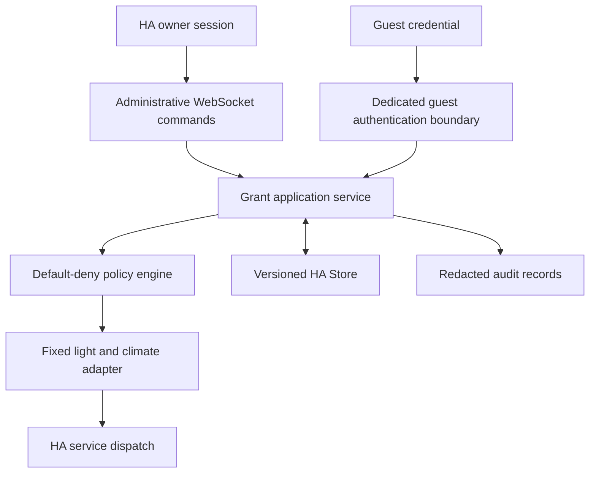

# MVP architecture proposal

Status: architecture approved on 2026-10-19. Phases 1–3 are implemented; this document describes the complete target architecture, including later work. See [Phase 3 status](phase-3.md) for the guest transport boundary and [Phase 2](phase-2.md) for device support.

## Home Assistant conventions reviewed

Use a custom integration with a manifest, config flow, setup/unload lifecycle, strings, and translations. A singleton config entry holds nonsecret configuration; typed `entry.runtime_data` owns the application service. Register administrative commands through HA's authenticated WebSocket API. Its authentication is HA-wide, so it is unsuitable for issuing guest credentials scoped only to this integration. [Config entries](https://developers.home-assistant.io/docs/config_entries_index/), [WebSocket API](https://developers.home-assistant.io/docs/api/websocket/), [authentication API](https://developers.home-assistant.io/docs/auth_api/).

The reviewed development source provides WebSocket admin/user decorators and versioned `Store` support. Atomic writes are an explicit storage option, not a default to assume. Implementation must recheck these interfaces against a pinned stable HA release; moving `dev` sources are design evidence, not a compatibility promise. [WebSocket decorators](https://github.com/home-assistant/core/blob/dev/homeassistant/components/websocket_api/decorators.py), [storage helper](https://github.com/home-assistant/core/blob/dev/homeassistant/helpers/storage.py).

## Boundaries



Guest authentication and transport are disabled until their release gate. The policy engine is pure: given validated principal, grant, request, entity capability snapshot, and time, it returns a decision and reason. Only the application service can obtain a fresh decision and immediately dispatch. A previous permission check is never a reusable authorization token.

The executor constructs the service name, a single exact entity target, and allowed service data itself. Guests cannot submit HA service data or select the service. HA `Context` provides correlation, not authorization; guest actions must not impersonate the homeowner's user ID.

## Setup and owner workflow

The owner adds SOLBUDDY Access through Settings → Devices & services. Setup enforces a single instance, initializes storage, and enables only administrative APIs. Guest transport later requires an explicitly configured trusted HTTPS origin. LAN membership alone never establishes trust.

For the first milestone, a documented owner WebSocket request creates a 72-hour grant. Listing, inspection, permission preview, and revocation use the same authenticated interface. This is functional but intentionally not a finished guest-management UI.

Native actions/services could later improve Developer Tools usability, but an HA service is not automatically owner-only: every call would need explicit current-user validation and denial of missing/system contexts. Defer this duplicate surface. Helpers are unsuitable as authoritative permission storage because editing a helper must not grant access. Defer a custom panel or separate web UI until the backend is secure.

## Execution and revocation

Use a global mutation lock for consistent storage snapshots and a per-grant gate for session admission, final checks, and command dispatch. Establish one lock order (grant gate, then storage lock); never acquire in reverse. Hold the grant gate through bounded HA service invocation. Owner revocation enters the same gate, marks the grant denied, invalidates its sessions, and awaits the durable save before reporting success. Queue limits and timeouts bound waits.

If execution enters first, that admitted command may complete. If revocation enters first, no subsequent command dispatches. After revocation succeeds, no new command for that grant can dispatch. A timeout or cancellation cannot guarantee cancellation of hardware work; return an unknown outcome and never automatically replay. Recheck expiry immediately before service invocation; expiration cannot undo an in-flight command.

On save failure, keep the grant blocked in memory, invalidate sessions, report persistence failure, and disable guest execution until recovery. Never report a durable revocation that was not saved. A restart discards all guest sessions and invitations, so stale credentials cannot regain access even if the disk contains the pre-failure grant. Recovery requires owner review before issuing new credentials.

## Persistence and lifecycle

Use a versioned `Store` under the HA storage directory with private file permissions and explicit atomic writes. Store grants, policies, owner attribution, revocation timestamps, and bounded audit records. Serialize all application writes; the Store's internal write lock alone does not prevent stale application snapshots. Await saves for creation and revocation; do not defer them with debounce timers. Publish new grants only after persistence succeeds.

Validate the complete loaded document and schema version before serving requests. Missing storage is acceptable only for a verified first initialization; an existing entry with unexpectedly missing or corrupt storage fails closed. Unknown schema versions and failed migrations preserve evidence and prevent guest execution. Do not silently replace bad data with an empty store.

Status is derived on reads; timer notifications improve UX but do not enforce access. Restart preserves grant policy and revocation but invalidates sessions/invitations. Unload first blocks new work, then drains bounded admitted work and removes timers. Registered handlers must reject requests without a live runtime; avoid duplicate registration on reload.

No `DataUpdateCoordinator` is needed: there is no remote data poll. Scheduled lifecycle notifications and HA state/registry events suffice. Deletion or identity changes disable affected bindings; require owner reapproval instead of silently following renamed/replaced targets.

## Proposed repository after approval

```text
custom_components/solbuddy_access/
  __init__.py         # lifecycle and typed runtime
  manifest.json      # version, config_flow, dependencies, documentation
  config_flow.py     # singleton UI setup
  const.py
  models.py          # immutable validated grant/policy/session types
  storage.py         # versioned native persistence and migrations
  grants.py          # lifecycle, application service, concurrency gates
  permissions.py     # pure default-deny evaluation
  executor.py        # fixed HA service mapping and capability checks
  auth.py            # principal/session interface; initially denies guests
  api.py             # owner WebSocket commands
  guest_api.py       # added only after authentication gate
  audit.py           # structured, redacted, bounded audit
  strings.json
  translations/en.json
tests/
  test_config_flow.py
  test_permissions.py
  test_grants.py
  test_storage.py
  test_api.py
  test_auth.py
  test_execution.py
  test_concurrency.py
docs/
README.md
AGENTS.md
LICENSE
pyproject.toml
.github/workflows/ci.yml
```

No entity platform is needed merely to manage grants. No `services.py` or polling coordinator is planned initially. Pin Python, HA fixtures, pytest, and Ruff in Phase 1 and record minimum/current tested HA versions. Use no invented repository URLs or code-owner identities in the manifest.
